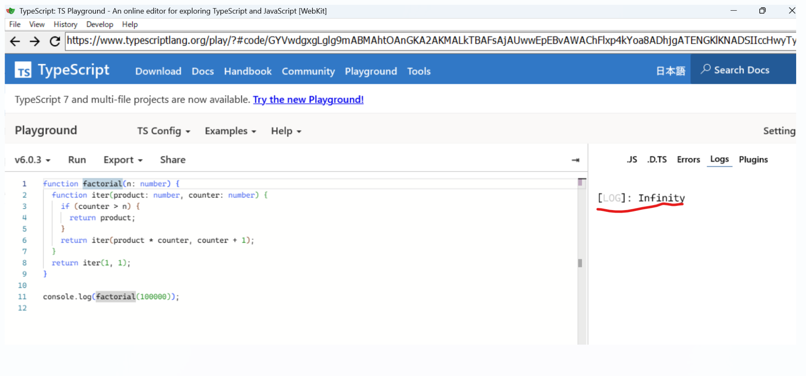
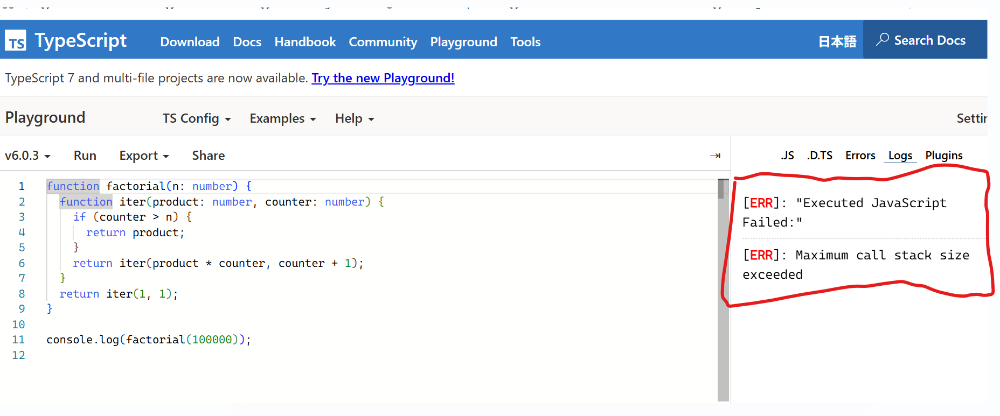

# 解答

## 1：プログラミング言語や処理系によっては、再帰呼び出しを関数の処理の末尾にする(末尾再帰)ことで、スタックオーバーフローが起こらないよう最適化できるものがある。末尾再帰は何故そのような最適化ができるのか答えなさい

通常の再帰では、再帰呼び出しの後に実行する処理が残っているため、呼び出し元の情報をスタック領域に保持しておく必要がある。

一方で末尾再帰では、再帰呼び出しが関数の最後の処理となり、呼び出し元に戻ってから実行する処理が残らないため、呼び出し元の情報を保持しておく必要がなく、処理系によっては現在のスタック領域を次の再帰呼び出しに再利用できる。

その結果、再帰呼び出しを繰り返してもスタック領域の使用量が増加せず、スタックオーバーフローを防ぐことができる。

### 具体例

階乗を求める関数で考える。

通常の再帰：

```js
function factorial(n) {
  if (n === 1) return 1;

  return n * factorial(n - 1); // 戻ってきた結果に n を掛ける処理が残る
}
```

末尾再帰：

```js
function factorial(n, result = 1) {
  if (n === 1) return result;

  return factorial(n - 1, n * result); // 呼び出したら、その結果をそのまま返すだけ
}
```

`factorial(3)` を実行したときのスタック領域は次のようになる。

通常の再帰では、呼び出し元が掛け算のために結果を待ち続けるので、フレームが積み上がる。

```text
スタック領域
┌──────────────────────┐
│ factorial(1)         │ ← 現在実行中
├──────────────────────┤
│ factorial(2)         │ ← 2 * factorial(1) の結果を待つ
├──────────────────────┤
│ factorial(3)         │ ← 3 * factorial(2) の結果を待つ
└──────────────────────┘
```

末尾再帰で最適化が行われた場合は同じフレームを再利用できる。

```text
スタック領域
┌──────────────────────┐
│ factorial(3, 1)      │
└──────────────────────┘
          ↓ 再利用
┌──────────────────────┐
│ factorial(2, 3)      │
└──────────────────────┘
          ↓ 再利用
┌──────────────────────┐
│ factorial(1, 6)      │
└──────────────────────┘
          ↓
       return 6
```

## 2：JavaScript で末尾再帰最適化を実装している処理系を答えなさい。 利用できる環境があれば、実際に以下の URL を表示・実行してエラーが発生しないことを確認しなさい

Safariで使用されているJavaScriptCoreが対応している。
自身のPCはWinddowsでSafariを使用できないため、Playwright経由で確認した。

### 確認方法

1. WebKit をインストールする

   ```sh
   npx playwright install webkit
   ```

2. WebKit で問題の URL を開く

   ```sh
   npx playwright open --browser=webkit "https://www.typescriptlang.org/play/?#code/GYVwdgxgLglg9mABMAhtOAnGKA2AKMALkTBAFsAjAUwwEpEBvAWAChFlxp4kYoa8ADhjgATENGKlKNADSIIccHwyTy1Oo1bt2MYIjwKlNRAD4S9Zm23sMVKCAxIho8VADcW7QF9PNuw55lQWExaEQAKnlFMGU5QxjjAGpEAEZaDysfK1t7R0RefhS5NIys1gUwAGc4HCoAOhw4AHM8VHQsXDwUgAZe3tp01iA"
   ```

3. 「Run」を押し、右側の「Logs」タブで結果を見る

### 確認結果

#### Safari



#### Chrome

v8では最適化が実装されていないためエラーでした


